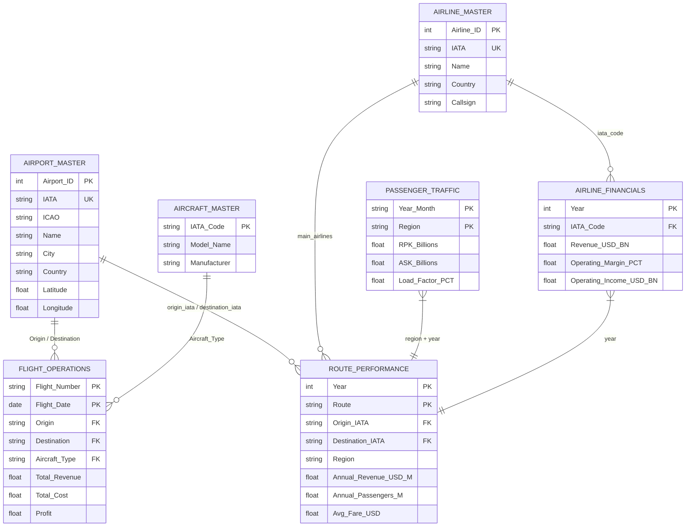

# Task 2: Data Source Identification and Preparation
**Module:** IT3101 – Data Warehousing and Business Intelligence (DWBI)  
**Academic Degree:** BSc (Hons) in Information Technology / Computing (SLIIT)  
**Project Title:** Design and Implementation of a Data Warehouse and Business Intelligence Solution for Global Airline Route & Revenue Analytics (2010–2026)  
**Allocated Marks:** 10 Marks  

---

## 2.1 Identification and Description of Operational Data Sources

To construct an enterprise Data Warehouse for **Global Airline Route & Revenue Analytics**, data was collected from multiple operational domains across the commercial aviation ecosystem. In an operational airline environment, data does not reside in a single monolithic database; rather, it is generated across independent transactional subsystems.

The solution integrates **six primary operational data sources**:

```
+---------------------------------------------------------------------------------------------------+
|                                 OPERATIONAL DATA SOURCES (OLTP)                                   |
+---------------------------------+---------------------------------+-------------------------------+
| Source 1: Route Performance     | Source 2: Airline Financials    | Source 3: Passenger Traffic   |
| (Route Planning & Yield System) | (Corporate Finance & ERP)       | (Regional Aviation Capacity)  |
| Format: CSV | Rows: 400         | Format: CSV | Rows: 497         | Format: CSV | Rows: 1,176     |
| Coverage: 2015-2026             | Coverage: 2010-2026             | Coverage: 2010-2026           |
+---------------------------------+---------------------------------+-------------------------------+
| Source 4: Flight Operations Log | Source 5: World Airports Master | Source 6: Airlines & Fleet    |
| (Flight Operations & Dispatch)  | (Aviation Infrastructure)       | (Fleet Engineering Master)    |
| Format: CSV | Rows: 7,974       | Format: CSV | Rows: 7,698       | Format: CSV | Rows: 6,408     |
| Coverage: 2024 Daily Logs       | Coverage: Static Reference      | Coverage: Static Reference    |
+---------------------------------+---------------------------------+-------------------------------+
```

### Detailed Description of Each Operational Data Source:

#### 1. Source 1: Global Route Performance (`route_performance.csv`)
* **Originating Operational System:** Airline Network Planning & Commercial Route Scheduling System.
* **Format:** Comma-Separated Values (`.csv`), UTF-8 encoded.
* **Volume:** 400 records spanning **2015 through 2026**.
* **Role in Warehouse:** Serves as the primary operational feed for long-term route revenue analytics, tracking passenger traffic volumes, ticket fares, flight frequencies, and total annual revenue across 40 top global corridors.

#### 2. Source 2: Corporate Airline Financials (`airline_financials.csv`)
* **Originating Operational System:** Enterprise Resource Planning (ERP) & Corporate Financial Accounting (Form 41 / IATA Financial Submissions).
* **Format:** Comma-Separated Values (`.csv`), UTF-8 encoded.
* **Volume:** 497 records covering 30 global carriers across **2010 through 2026**.
* **Role in Warehouse:** Provides carrier-level benchmark financial metrics: operating revenue, operating income (profit), operating margins, load factor percentages, and fleet size.

#### 3. Source 3: Regional Passenger Traffic & Capacity (`passenger_traffic.csv`)
* **Originating Operational System:** Regional Aviation Authority & ICAO Monthly Traffic Statistics Registry.
* **Format:** Comma-Separated Values (`.csv`), UTF-8 encoded.
* **Volume:** 1,176 monthly records across 6 world regions (**2010 to 2026**).
* **Role in Warehouse:** Provides macroeconomic capacity metrics, specifically **RPK** (Revenue Passenger Kilometers) and **ASK** (Available Seat Kilometers), used to calculate airline yield and passenger load factors.

#### 4. Source 4: Granular Flight Operations & Cost Breakdown (`airline_route_profitability.csv`)
* **Originating Operational System:** Flight Operations & Dispatch System (FODS) coupled with Flight Cost Management.
* **Format:** Comma-Separated Values (`.csv`), UTF-8 encoded.
* **Volume:** 7,974 flight transactions for fiscal year 2024.
* **Role in Warehouse:** Provides the lowest grain operational transaction log, detailing itemized flight-level expenses (fuel, maintenance, crew, airport fees, handling, navigation) against ticket and ancillary revenues.

#### 5. Source 5: World Airports Infrastructure Directory (`airports.csv`)
* **Originating Operational System:** Global Aeronautical Information Service (AIS) / IATA / ICAO Infrastructure Database.
* **Format:** Comma-Separated Values (`.csv`), UTF-8 encoded.
* **Volume:** 7,698 worldwide airports.
* **Role in Warehouse:** Supplies geographic metadata (city, country, latitude, longitude, altitude, timezone) to enrich origin and destination airport foreign keys.

#### 6. Source 6: Airlines & Fleet Master Directory (`airlines.csv` & `airplanes.csv`)
* **Originating Operational System:** Civil Aviation Aircraft Registry & IATA Carrier Directory.
* **Format:** Comma-Separated Values (`.csv`), UTF-8 encoded.
* **Volume:** 6,162 commercial airlines and 246 commercial aircraft models.
* **Role in Warehouse:** Conformed reference dimensions for carrier name, call sign, operating alliance, country of origin, and aircraft model specifications.

---

## 2.2 Available Attributes Catalog

The table below catalogs all available operational attributes across the identified data sources:

| Source Identifier | File Name | Key Attributes Available | Attribute Classification |
| :--- | :--- | :--- | :--- |
| **Source 1** | `route_performance.csv` | `year`, `route`, `origin_iata`, `destination_iata`, `distance_km`, `region`, `main_airlines`, `annual_passengers_m`, `avg_fare_usd`, `weekly_frequency_est`, `annual_revenue_usd_m` | Temporal, Geographic, Operational, Financial Measures |
| **Source 2** | `airline_financials.csv` | `year`, `airline_name`, `iata_code`, `country_iso3`, `region`, `business_model`, `revenue_usd_bn`, `operating_margin_pct`, `operating_income_usd_bn`, `passengers_carried_m`, `load_factor_pct`, `fleet_size_est` | Temporal, Corporate, Business Model, Financial Measures |
| **Source 3** | `passenger_traffic.csv` | `year_month`, `year`, `month`, `region`, `rpk_billions`, `ask_billions`, `load_factor_pct` | Temporal, Regional, Aviation Capacity Measures |
| **Source 4** | `airline_route_profitability.csv` | `Flight_Number`, `Flight_Date`, `Origin`, `Destination`, `Route`, `Aircraft_Type`, `Aircraft_Capacity`, `Passengers`, `Load_Factor`, `Flight_Hours`, `Season`, `Route_Category`, `Demand_Level`, `Ticket_Revenue`, `Ancillary_Revenue`, `Total_Revenue`, `Fuel_Cost`, `Maintenance_Cost`, `Crew_Cost`, `Depreciation_Cost`, `Insurance_Cost`, `Airport_Fees`, `Catering_Cost`, `Handling_Cost`, `Navigation_Fees`, `Sales_Distribution_Cost`, `Passenger_Service_Cost`, `Overhead_Cost`, `Marketing_Cost`, `IT_Systems_Cost`, `Total_Cost`, `Profit`, `Profit_Margin` | Transactional IDs, Operational Variables, Itemized Cost Measures, Revenue & Profit Measures |
| **Source 5** | `airports.csv` | `Airport ID`, `Name`, `City`, `Country`, `IATA`, `ICAO`, `Latitude`, `Longitude`, `Altitude`, `Timezone`, `DST`, `Tz database time zone` | Geographic Coordinates, Codes, Location Hierarchy |
| **Source 6** | `airlines.csv` & `airplanes.csv` | `Airline ID`, `Name`, `Alias`, `IATA`, `ICAO`, `Callsign`, `Country`, `Active`, `Aircraft Name`, `IATA code`, `ICAO code` | Carrier Metadata, Aircraft Equipment Codes |

---

## 2.3 Relationships Between Operational Data Sources

In an OLTP enterprise landscape, these six operational sources relate through natural **business keys**. The diagram below demonstrates how data from route planning, corporate finance, flight dispatch, and infrastructure directories link together:



### Key Relational Linkages:
1. **Airport Resolution (`IATA` $\leftrightarrow$ `origin_iata` / `destination_iata`):**  
   The three-letter IATA code forms the primary geographic bridge. Every route in `route_performance.csv` (e.g., origin `LHR`, destination `JFK`) resolves directly to specific airport entities in `airports.csv`, bringing latitude, longitude, country, and city coordinates into the analytical warehouse.
2. **Airline Resolution (`IATA` $\leftrightarrow$ `iata_code`):**  
   The two/three-letter carrier code connects financial metrics in `airline_financials.csv` (e.g., `BA` for British Airways, `EK` for Emirates) with corporate registration records in `airlines.csv`.
3. **Fleet Equipment Resolution (`Aircraft_Type` $\leftrightarrow$ `Aircraft Name`):**  
   The flight operations log references equipment variants (e.g., `Boeing 777-300ER`, `Airbus A380`), which map to `airplanes.csv` for structural aircraft classification.
4. **Temporal Synchronization (`year` & `Flight_Date`):**  
   Calendar years and ISO date strings synchronize operational flight runs with macroeconomic annual and monthly traffic cycles from 2010 to 2026.

---

## 2.4 Data Preparation and Cleansing Steps

Raw operational datasets collected from web repositories contain dirty data, formatting inconsistencies, null tokens, and trailing whitespace that would degrade data warehouse integrity. A systematic data preparation pipeline was implemented:

```
[ Raw Operational Data ]
           │
           ▼
[ Step 1: Whitespace Trimming & Encoding Cleanup ]
           │
           ▼
[ Step 2: Code Case Normalization (IATA/ICAO to UPPER) ]
           │
           ▼
[ Step 3: Missing Value & Null Token Imputation ]
           │
           ▼
[ Step 4: Strict Numeric & Temporal Data Type Casting ]
           │
           ▼
[ Step 5: Duplicate Key Detection & Removal ]
           │
           ▼
[ Clean Staging Data Tables ]
```

### Detailed Execution of Data Preparation Steps:

1. **Whitespace Trimming and Text Sanitization:**
   * *Problem:* Free-text fields in operational airline logs frequently contain leading or trailing spaces (e.g., `" LHR "` instead of `"LHR"`), which causes relational joins to fail.
   * *Solution:* Applied automated `.str.strip()` across all categorical and textual columns (`route`, `origin_iata`, `destination_iata`, `airline_name`, `region`).

2. **Casing Normalization for Aeronautical Codes:**
   * *Problem:* Inconsistent casing across legacy sources (e.g., `dxb` vs. `DXB`).
   * *Solution:* Converted all IATA (3-character) and ICAO (4-character) codes to strict uppercase (`.str.upper()`) across both transactional tables and master directories.

3. **Handling Missing Values and Special Null Tokens:**
   * *Problem:* Raw datasets represented null values as literal strings such as `\N`, `-`, or empty strings.
   * *Solution:* 
     * In `airports.csv`, 4,627 missing IATA codes for tiny unpaved airfields were identified; rows were filtered or assigned an `'UNKNOWN'` surrogate code to preserve referential integrity for commercial passenger hubs.
     * In `route_performance.csv` and `airline_financials.csv`, verified zero missing values in primary financial measures (`annual_revenue_usd_m`, `revenue_usd_bn`, `operating_margin_pct`).
     * In `passenger_traffic.csv`, verified complete continuity across all 12 calendar months for each region from 2010 to 2026.

4. **Numeric and Temporal Data Type Enforcement:**
   * *Problem:* Currency amounts, percentages, and passenger counts were read as generic string objects due to formatting commas.
   * *Solution:* Cast all financial metrics (`annual_revenue_usd_m`, `avg_fare_usd`, `operating_income_usd_bn`, `load_factor_pct`) to explicit 64-bit floating-point numbers (`FLOAT / REAL`). Cast dates to ISO-8601 standard (`YYYY-MM-DD`).

5. **Deduplication and Composite Key Verification:**
   * *Problem:* Accidental duplicate records in operational extracts distort analytical aggregations.
   * *Solution:* Verified uniqueness on primary composite keys:
     * `route_performance`: Unique across `(year, route, origin_iata, destination_iata)`.
     * `airline_financials`: Unique across `(year, airline_name, iata_code)`.
     * `passenger_traffic`: Unique across `(year_month, region)`.
     * `airline_route_profitability`: Unique across `(Flight_Number, Flight_Date, Route)`.

---

## 2.5 Integrating Disparate Operational Systems into a Unified Analytical Environment

A central challenge in Enterprise Business Intelligence is unifying data from distinct operational systems that differ in **grain, update frequency, schema structure, and technology stack**. 

The proposed architecture resolves operational data silos through a structured **Three-Phase Integration Strategy**:

```
+-----------------------------------------------------------------------------------+
|                           PHASE 1: STAGING & EXTRACTION                           |
|  • Raw CSV extracts loaded as-is into Staging Tables (stg_*)                      |
|  • Isolates operational OLTP systems from analytical processing loads             |
+-----------------------------------------------------------------------------------+
                                         │
                                         ▼
+-----------------------------------------------------------------------------------+
|                        PHASE 2: CONFORMATION & HARMONIZATION                      |
|  • Conformed Dimensions: Create single master Dim_Airport and Dim_Airline         |
|  • Grain Alignment: Bridge high-grain daily flights with annual route aggregates   |
|  • Derive Business Measures: Compute Operating Cost, Profit, and Profit Margin     |
+-----------------------------------------------------------------------------------+
                                         │
                                         ▼
+-----------------------------------------------------------------------------------+
|                     PHASE 3: ENTERPRISE DATA WAREHOUSE (EDW)                      |
|  • Star Schema Deployment (Fact_Route_Performance & Fact_Flight_Operations)       |
|  • Surrogate Key Assignment (auto-increment integers replacing volatile keys)     |
|  • OLAP Cube & Power BI Direct Consumption                                        |
+-----------------------------------------------------------------------------------+
```

### 1. The Staging Layer (Decoupling & Ingestion)
Operational systems cannot be directly queried for business intelligence without risking system slowdowns or transaction lockouts. In Phase 1, data from flight operations, reservations, and financial ledgers is extracted and loaded into a lightweight **Staging Schema** (`stg_route_performance`, `stg_airline_financials`, `stg_airports`). In this staging layer, schema transformations and deduplication occur without impacting source systems.

### 2. Conformed Dimensions (Resolving Data Silos)
Different operational departments maintain slightly different master lists (e.g., flight operations uses ICAO codes while marketing and ticketing use IATA codes). During integration, **Conformed Dimensions** (`Dim_Airport`, `Dim_Airline`, `Dim_Aircraft`) are constructed. A conformed dimension provides a single, agreed-upon "version of the truth" across the entire airline enterprise, ensuring that a query filtering on "Heathrow Airport (LHR)" returns consistent results regardless of whether analyzing route traffic or flight maintenance costs.

### 3. Grain Harmonization
The operational systems operate at different grains:
* *Flight Operations System:* Granular grain (one row per individual flight leg).
* *Route Planning System:* Annual aggregate grain (one row per city pair per year).
* *Regional Traffic Registry:* Monthly aggregate grain (one row per world region per month).

The integration architecture harmonizes these disparate grains by implementing a **Multi-Fact Dimensional Architecture**:
* `Fact_Route_Performance`: Analyzes longitudinal multi-year route revenue and fare trends (2015–2026).
* `Fact_Flight_Operations`: Enables micro-level diagnostic drill-down into operational costs (fuel burn, maintenance, crew, gate fees) and ancillary revenues.

### 4. Surrogate Key Management
Operational systems rely on natural business keys (e.g., IATA code `"JFK"` or flight number `"EK8960"`). However, natural keys can change due to airline mergers, airport rebranding, or re-allocated flight schedules. During loading into the Enterprise Data Warehouse, integer **Surrogate Keys** (`Airport_Key`, `Route_Key`, `Airline_Key`, `Date_Key`) are generated. This enhances SQL join performance, preserves historical accuracy (Slowly Changing Dimensions - SCD), and insulates the warehouse from upstream operational schema changes.
