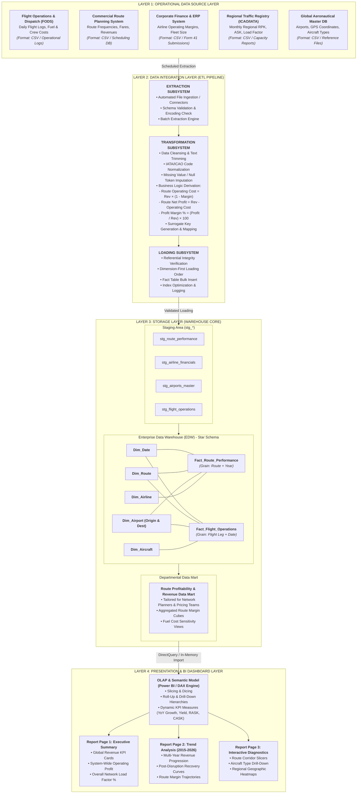

# Task 3: Data Warehouse Architecture Design
**Module:** IT3101 – Data Warehousing and Business Intelligence (DWBI)  
**Academic Degree:** BSc (Hons) in Information Technology / Computing (SLIIT)  
**Project Title:** Design and Implementation of a Data Warehouse and Business Intelligence Solution for Global Airline Route & Revenue Analytics (2010–2026)  
**Allocated Marks:** 10 Marks  

---

## 3.1 High-Level Architecture Overview

To resolve the operational data silos and support strategic commercial decision-making across global airline operations, an end-to-end **Four-Tier Enterprise Data Warehouse & Business Intelligence Architecture** was engineered. 

The architecture follows the industry-standard **Kimball Dimensional Data Warehouse Bus Architecture** combined with an isolated **Staging Layer** and specialized **Departmental Data Marts**. This design decouples high-throughput transactional Online Transaction Processing (OLTP) sources from compute-intensive analytical Online Analytical Processing (OLAP) queries, ensuring zero disruption to live flight operations while delivering sub-second response times for executive dashboards.

The four functional layers of the architecture are:
1. **Data Source Layer (OLTP & External Systems)**
2. **Data Integration Layer (ETL Engine)**
3. **Data Storage Layer (Staging, Enterprise Data Warehouse, and Data Marts)**
4. **Presentation & Analytics Layer (OLAP Engine & BI Dashboards)**

---

## 3.2 End-to-End Architecture Diagram

The diagram below provides a complete structural view of data flowing from operational sources through the integration pipeline into the analytical presentation tier:



---

## 3.3 Layer 1: Data Source Layer

The **Data Source Layer** represents the origin of all business transactions, master registries, and macroeconomic benchmarks within the global aviation ecosystem. These operational systems operate autonomously across different airline divisions:

1. **Flight Operations & Dispatch System (FODS):**
   * *Business Role:* Manages real-time flight movements, aircraft tail routing, block flight hours, and fuel loads.
   * *Extracted Entities:* Daily flight operations (`airline_route_profitability.csv`), capturing flight dates, origin/destination hubs, aircraft models, passengers boarded, and itemized direct flight costs (fuel, crew, maintenance reserves, catering, and airport landing fees).

2. **Commercial Route Planning & Scheduling System:**
   * *Business Role:* Strategizes route networks, seasonal flight frequencies, and base passenger fare tariffs.
   * *Extracted Entities:* Annual route traffic statistics (`route_performance.csv`), tracking 40 major international corridors across 14 geographic sectors from 2015 to 2026.

3. **Corporate Finance & Enterprise Resource Planning (ERP):**
   * *Business Role:* Tracks carrier corporate balance sheets, quarterly regulatory filings (DOT Form 41 / IATA WATS), and operational margins.
   * *Extracted Entities:* Carrier financial performance records (`airline_financials.csv`), detailing annual corporate operating revenue, operating income, profit margin percentages, and active fleet capacity for 30 global airlines.

4. **Regional Aviation Capacity & Statistical Registries:**
   * *Business Role:* Global regulatory authorities (ICAO) aggregating international air traffic metrics.
   * *Extracted Entities:* Regional capacity records (`passenger_traffic.csv`), providing monthly Revenue Passenger Kilometers (RPK), Available Seat Kilometers (ASK), and seat occupancy rates across 6 world continents.

5. **Aeronautical Master Infrastructure Registries:**
   * *Business Role:* International clearinghouse records maintaining standardized aeronautical coding.
   * *Extracted Entities:* Master airport coordinates (`airports.csv`), airline call signs (`airlines.csv`), and aircraft equipment families (`airplanes.csv`).

---

## 3.4 Layer 2: Data Integration Layer (ETL Engine)

The **Data Integration Layer** acts as the analytical processing backbone. It is responsible for orchestrating the extraction, transformation, quality assurance, and loading of heterogeneous source feeds into the warehouse repository.

### 1. Extraction Subsystem
* **Decoupled Ingestion:** Operational data is extracted using scheduled automated batch pipelines without issuing long-running aggregation locks on source OLTP transaction tables.
* **Format Parsers:** Specialized ingestion adapters parse delimited text files (`.csv`), spreadsheets (`.xlsx`), and semi-structured payloads (`.json`).
* **Metadata Tagging:** Ingested batches are tagged with audit attributes: `Load_Timestamp`, `Source_System_ID`, and `Batch_Run_ID` to support end-to-end data lineage.

### 2. Transformation Subsystem
The transformation subsystem applies business rules, data standardization, and derived metric calculations:
* **Data Cleansing:** Strips whitespace, sanitizes free text fields, and standardizes date formats to ISO-8601 (`YYYY-MM-DD`).
* **Code Normalization:** Maps diverse carrier and airport notations into uniform 3-letter IATA and 4-letter ICAO standards.
* **Missing Value Imputation:** Resolves unrecorded attributes by replacing nulls with standardized dimension tokens (`'UNKNOWN'`) to prevent broken inner joins.
* **Business Logic & Derived Attribute Creation:**
  In accordance with Task 5 rubric requirements, essential aviation financial KPIs are mathematically derived during transformation:
  $$\text{Route Operating Cost} = \text{Annual Revenue (USD M)} \times \left(1 - \frac{\text{Carrier Operating Margin \%}}{100}\right)$$
  $$\text{Route Net Operating Profit} = \text{Annual Revenue (USD M)} - \text{Route Operating Cost}$$
  $$\text{Route Net Profit Margin \%} = \left(\frac{\text{Route Net Operating Profit}}{\text{Annual Revenue (USD M)}}\right) \times 100$$
  $$\text{Revenue per Available Seat Kilometer (RASK)} = \frac{\text{Passenger Revenue}}{\text{ASK}}$$
  $$\text{Cost per Available Seat Kilometer (CASK)} = \frac{\text{Total Operating Cost}}{\text{ASK}}$$
* **Surrogate Key Generation:** Natural keys (e.g., `"LHR"`, `"DXB-JFK"`) are translated into synthetic integer keys (`Airport_Key`, `Route_Key`) via hash mapping or sequential key pipelines.

### 3. Loading Subsystem
* **Loading Order Orchestration:** Enforces strict parent-child loading sequences: independent Dimension tables (`Dim_Date`, `Dim_Airport`, `Dim_Airline`, `Dim_Aircraft`) are loaded and verified before dependent Fact tables (`Fact_Route_Performance`, `Fact_Flight_Operations`) are populated.
* **Referential Integrity Enforcement:** Foreign keys in fact tables are checked against dimension surrogate key lookups. Unmatched records are routed to an Error Log Staging Table rather than failing the entire batch run.
* **Performance Indexing:** Fact tables are loaded using bulk-insert operations, followed by automatic index creation (clustered columnstore / B-tree indexes) on all foreign keys to maximize analytical query throughput.

---

## 3.5 Layer 3: Data Storage Layer (Warehouse Core)

The **Storage Layer** provides organized, durable, and performant data persistence across three distinct storage zones:

```
[ Storage Zone 1: Staging Area ]
           │  (Decoupled transient tables: stg_route, stg_financials, stg_airports)
           ▼
[ Storage Zone 2: Enterprise Data Warehouse (EDW) ]
           │  (Central Star Schema with Conformed Dimensions & Scalable Facts)
           ▼
[ Storage Zone 3: Departmental Data Mart ]
              (Route Profitability & Revenue Management Data Mart)
```

### Component A: Staging Area (`stg_*`)
* **Architecture:** Transient staging database schema (`DW_STAGING`).
* **Design Philosophy:** Replicates source table structures with relaxed constraints. No business users or reporting tools are permitted direct access to this zone.
* **Purpose:** Provides a staging buffer where data cleaning, character set conversions, and deduplication occur without imposing computational overhead on the production warehouse.

### Component B: Enterprise Data Warehouse (EDW)
* **Architecture:** Dimensional Model (Star Schema) deployed on an enterprise relational engine (Microsoft SQL Server / PostgreSQL).
* **Conformed Dimensions:**
  * `Dim_Date`: Comprehensive calendar dimension (Year, Quarter, Month, Day, Weekday, Peak Travel Season Indicator).
  * `Dim_Route`: Route dimension (Route Corridor, Distance km, Long/Medium/Short Haul Category, Corridor Region).
  * `Dim_Airport`: Role-playing dimension instantiated as `Dim_Origin_Airport` and `Dim_Destination_Airport` (Airport Name, City, Country, Latitude, Longitude, Elevation, Timezone).
  * `Dim_Airline`: Carrier dimension (Airline Name, IATA Code, Callsign, Country, Business Model: Legacy vs. LCC).
  * `Dim_Aircraft`: Fleet dimension (Aircraft Family, Model Variant, Engine Type, Typical Seat Capacity).
* **Fact Tables:**
  * `Fact_Route_Performance`: Captures annual route-level financials and passenger loads across 2015–2026.
  * `Fact_Flight_Operations`: Captures flight-leg operational expenses, ticket revenues, ancillary fees, and net margins.

### Component C: Departmental Data Mart
* **Target Mart:** **Route Profitability & Revenue Management Data Mart**.
* **Target User Personas:** Chief Commercial Officers (CCO), Airline Network Planners, Route Pricing Strategists, and Fuel Procurement Managers.
* **Analytical Benefits:** 
  Pre-aggregates route performance by corridor and fiscal quarter, isolating route margin drivers, seasonal demand swings, and fuel price sensitivity without requiring analysts to run expensive joins across raw transaction tables.

---

## 3.6 Layer 4: Presentation & Analytics Layer (BI & OLAP)

The **Presentation Layer** is the user-facing analytical tier, enabling business stakeholders to explore data dynamically through interactive dashboards and OLAP cubes:

### 1. OLAP Semantic Modeling Engine
* Built using the **Microsoft Power BI / VertiPaq In-Memory Engine** (or Tableau Data Engine).
* Implements robust **DAX (Data Analysis Expressions)** measures for dynamic runtime aggregation:
  * Dynamic YoY Revenue Growth %:
    $$\text{YoY Revenue Growth} = \frac{\text{Current Year Revenue} - \text{Prior Year Revenue}}{\text{Prior Year Revenue}} \times 100$$
  * Dynamic Weighted Average Load Factor:
    $$\text{Network Load Factor \%} = \frac{\sum \text{Revenue Passenger Kilometers (RPK)}}{\sum \text{Available Seat Kilometers (ASK)}} \times 100$$
* Supports multidimensional OLAP operations:
  * **Roll-up:** Aggregating flight routes into regional corridors (e.g., LHR-JFK and CDG-JFK rolled up into "North Atlantic Corridor").
  * **Drill-down:** Navigating from global annual revenue down to individual route-level passenger fare distributions.
  * **Slice & Dice:** Isolating performance by specific carrier alliances, aircraft types, or travel seasons.

### 2. Interactive Business Intelligence Dashboard (Power BI / Tableau)
Designed around a structured three-page narrative aligned with Task 7 requirements:
* **Report Page 1: Executive Summary**  
  * High-level KPI scorecards (Total Network Revenue, Overall Operating Margin %, Total Passengers Transported).
  * Visual summary cards and gauge indicators showing performance against industry benchmarks.
* **Report Page 2: Trend Analysis (2015–2026)**  
  * 11-year multi-year time-series line and area charts.
  * Historical recovery trends post-pandemic (2020–2022) through recent operational expansion (2024–2026).
  * Long-term passenger yield and fare evolution across global corridors.
* **Report Page 3: Interactive Diagnostics & Route Drill-Down**  
  * Interactive route slicers, regional dropdowns, and carrier filters.
  * Geographic route map visualization using latitude and longitude coordinates.
  * Profitability decomposition matrix ranking corridors by profit margin percentage.

---

## 3.7 Architectural Benefits and Quality Attributes

The engineered 4-tier architecture delivers critical enterprise qualities:
1. **Scalability:** The decoupled staging and star schema easily scale to accommodate millions of future flight records without requiring architectural redesign.
2. **Data Consistency (Single Version of the Truth):** Conformed dimensions ensure that airport names, distance calculations, and financial definitions remain uniform across all departmental reports.
3. **High Query Performance:** Fact table surrogate integer keys and star schema topology minimize join complexity, enabling instantaneous dashboard visual rendering.
4. **Resilience & Governance:** The isolated staging layer guarantees that dirty source data is quarantined and cleansed before reaching production analytical layers.
