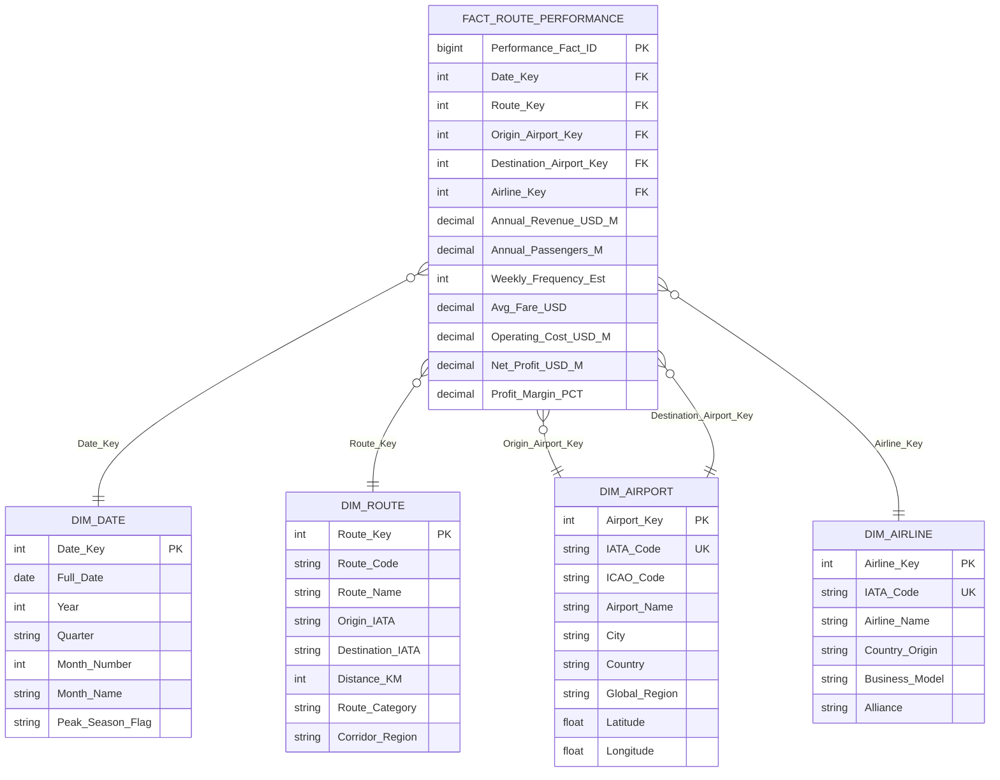

# Task 4: Dimensional Data Warehouse Design and Implementation
**Module:** IT3101 – Data Warehousing and Business Intelligence (DWBI)  
**Academic Degree:** BSc (Hons) in Information Technology / Computing (SLIIT)  
**Project Title:** Design and Implementation of a Data Warehouse and Business Intelligence Solution for Global Airline Route & Revenue Analytics (2010–2026)  
**Allocated Marks:** 20 Marks  

---

## 4.1 Business Process and Grain Identification

In accordance with the **Kimball Dimensional Modeling Methodology**, the foundation of a robust data warehouse begins with identifying the core business processes and defining the atomic grain of each fact table.

### 1. Selected Business Process
The primary business process modeled is **Commercial Flight Route Operations and Revenue Performance**. This process captures the commercial execution of scheduled flights across international city pairs, recording passenger demand, fare yields, operational revenues, direct operating expenses (fuel, crew, maintenance, navigation, airport landing fees), and net profitability.

### 2. Grain Definition
To accommodate both macro-level longitudinal trend analysis (2015–2026) and micro-level flight cost diagnostics, a dual-grain dimensional model is established:

* **Primary Fact Grain (`Fact_Route_Performance`):**  
  $$\textbf{Grain: One row per airline route corridor per calendar year.}$$
  *Example:* Route `LHR-JFK` (London Heathrow to New York JFK) for fiscal year `2024`.
  *Justification:* This grain directly supports executive reporting, multi-year capacity planning, passenger fare trends, and route margin comparisons spanning 2015 through 2026 without data sparsity.

* **Secondary Fact Grain (`Fact_Flight_Operations`):**  
  $$\textbf{Grain: One row per individual scheduled flight departure leg.}$$
  *Example:* Flight `EK8960` departing `DXB` to `ORD` on `2024-12-20`.
  *Justification:* Enables operational deep-dive analysis into itemized flight-level cost drivers (fuel burn, maintenance reserves, catering, and gate fees) against ticket and ancillary revenue.

---

## 4.2 Fact Table Design and Measures Specification

### 1. `Fact_Route_Performance` (Primary Enterprise Fact)
The primary fact table captures route-level operational metrics and derived profitability measures.

* **Foreign Keys:**
  * `Date_Key` *(INT)* $\rightarrow$ references `Dim_Date(Date_Key)`
  * `Route_Key` *(INT)* $\rightarrow$ references `Dim_Route(Route_Key)`
  * `Origin_Airport_Key` *(INT)* $\rightarrow$ references `Dim_Airport(Airport_Key)`
  * `Destination_Airport_Key` *(INT)* $\rightarrow$ references `Dim_Airport(Airport_Key)`
  * `Airline_Key` *(INT)* $\rightarrow$ references `Dim_Airline(Airline_Key)`

* **Measures Classification:**

| Measure Name | SQL Data Type | Measure Category | Formula / Definition | Analytical Purpose |
| :--- | :--- | :--- | :--- | :--- |
| `Annual_Revenue_USD_M` | `DECIMAL(12,2)` | **Fully Additive** | Gross route revenue in Millions USD | Total revenue generated across corridors |
| `Annual_Passengers_M` | `DECIMAL(10,3)` | **Fully Additive** | Total passengers transported (Millions) | Passenger traffic volume analysis |
| `Weekly_Frequency_Est` | `INT` | **Semi-Additive** | Average flights per week | Operational flight frequency |
| `Distance_KM` | `INT` | **Non-Additive** | Nautical route distance in kilometers | Mileage and flight corridor length |
| `Avg_Fare_USD` | `DECIMAL(8,2)` | **Non-Additive** | $\frac{\text{Annual Revenue}}{\text{Annual Passengers}}$ | Ticket pricing and yield tracking |
| `Operating_Cost_USD_M` | `DECIMAL(12,2)` | **Fully Additive** | $\text{Revenue} \times \left(1 - \frac{\text{Margin \%}}{100}\right)$ | Total direct and indirect route expenses |
| `Net_Profit_USD_M` | `DECIMAL(12,2)` | **Fully Additive** | $\text{Annual Revenue} - \text{Operating Cost}$ | True financial route contribution |
| `Profit_Margin_PCT` | `DECIMAL(6,2)` | **Non-Additive** | $\left(\frac{\text{Net Profit}}{\text{Annual Revenue}}\right) \times 100$ | Relative profitability benchmark |

> **Additivity Rule Note:** While `Net_Profit_USD_M` and `Annual_Revenue_USD_M` can be summed across any dimension (time, region, carrier), percentage metrics like `Profit_Margin_PCT` and `Avg_Fare_USD` must be computed dynamically in the OLAP layer using DAX formulas:
> $$\text{Profit Margin \%} = \frac{\sum \text{Net Profit}}{\sum \text{Annual Revenue}} \times 100$$

---

## 4.3 Dimension Tables Design and Hierarchies

Dimensions provide the descriptive context ("who, where, what, when") surrounding the business process facts. Integer surrogate keys are deployed across all dimensions to guarantee historical isolation from operational source key changes.

### 1. Date Dimension (`Dim_Date`)
* **Surrogate Key:** `Date_Key` *(INT - Format YYYYMMDD or sequential integer)*
* **Attributes:** `Full_Date`, `Year`, `Quarter`, `Quarter_Name` (Q1, Q2, Q3, Q4), `Month_Number` (1-12), `Month_Name` (January-December), `Day_of_Month`, `Day_of_Week` (Monday-Sunday), `Weekend_Flag` (Y/N), `Peak_Season_Flag` (Peak, Shoulder, Low).
* **Hierarchies:**
  $$\text{Calendar Year} \longrightarrow \text{Quarter} \longrightarrow \text{Month} \longrightarrow \text{Date}$$

### 2. Route Dimension (`Dim_Route`)
* **Surrogate Key:** `Route_Key` *(INT)*
* **Natural Key:** `Route_Code` (e.g., `"LHR-JFK"`, `"DXB-BOM"`)
* **Attributes:** `Route_Name`, `Origin_IATA`, `Destination_IATA`, `Distance_KM`, `Route_Category` (Long Haul, Medium Haul, Short Haul), `Corridor_Region` (North Atlantic, Transpacific, Intra-Asia, Europe-Middle East), `Domestic_International_Flag`.
* **Hierarchies:**
  $$\text{Corridor Region} \longrightarrow \text{Route Category (Haul Type)} \longrightarrow \text{Route Corridor}$$

### 3. Airport Dimension (`Dim_Airport`) — Role-Playing Dimension
* **Surrogate Key:** `Airport_Key` *(INT)*
* **Natural Key:** `IATA_Code` *(CHAR[3])* and `ICAO_Code` *(CHAR[4])*
* **Attributes:** `Airport_Name`, `City`, `Country`, `Country_ISO3`, `Global_Region` (Europe, North America, Asia-Pacific, Latin America, Middle East, Africa), `Latitude`, `Longitude`, `Altitude_FT`, `Timezone_Offset`.
* **Role-Playing Implementation:**
  The physical table `Dim_Airport` is referenced twice in the Fact table through role-playing foreign keys:
  1. `Origin_Airport_Key` represents the departure hub.
  2. `Destination_Airport_Key` represents the arrival hub.
* **Hierarchies:**
  $$\text{Global Region} \longrightarrow \text{Country} \longrightarrow \text{City} \longrightarrow \text{Specific Airport}$$

### 4. Airline Carrier Dimension (`Dim_Airline`)
* **Surrogate Key:** `Airline_Key` *(INT)*
* **Natural Key:** `IATA_Code` *(CHAR[2/3])*
* **Attributes:** `Airline_Name`, `Callsign`, `Country_Origin`, `Business_Model` (`legacy` full-service network carrier vs. `low_cost` budget carrier), `Alliance` (Star Alliance, SkyTeam, Oneworld, Independent), `Active_Status`.
* **Hierarchies:**
  $$\text{Global Alliance} \longrightarrow \text{Business Model} \longrightarrow \text{Commercial Airline Carrier}$$

### 5. Aircraft Fleet Dimension (`Dim_Aircraft`)
* **Surrogate Key:** `Aircraft_Key` *(INT)*
* **Natural Key:** `Aircraft_Model_Name` (e.g., `"Boeing 777-300ER"`, `"Airbus A380"`, `"Airbus A320"`)
* **Attributes:** `Manufacturer` (Boeing, Airbus, Embraer, COMAC), `Aircraft_Family` (B777, B787, A350, A380, A320), `Body_Type` (Wide-Body, Narrow-Body, Regional Jet), `Typical_Seating_Capacity`, `Fuel_Burn_Class`.
* **Hierarchies:**
  $$\text{Manufacturer} \longrightarrow \text{Aircraft Family} \longrightarrow \text{Body Type} \longrightarrow \text{Specific Model Variant}$$

---

## 4.4 Dimensional Star Schema Topology

The chosen schema architecture is a **Star Schema**. The star schema provides the highest query execution performance in analytical databases, eliminates redundant joins, and integrates cleanly with the Microsoft Power BI VertiPaq memory engine.

---

## 4.5 Dimensional Design Assumptions and Rules

1. **Surrogate Key Assignment:**
   All primary keys in dimension tables are synthetic auto-incrementing integers (`INT IDENTITY(1,1)`). Business keys (such as `origin_iata`) are retained solely as descriptive attributes and lookup candidates during ETL extraction. This ensures optimal join performance and handles upstream re-allocations of codes.

2. **Role-Playing Dimension Handling:**
   The `Dim_Airport` table participates in multiple distinct relationships with the fact table (Origin Airport vs. Destination Airport). In SQL and Power BI, this is handled through **role-playing views** (`View_Origin_Airport` and `View_Destination_Airport`) referencing the single physical table, preventing schema bloat while enabling origin/destination slicing.

3. **Slowly Changing Dimensions (SCD) Policy:**
   * **SCD Type 1 (Overwrites):** Applied to static infrastructure attributes where historical change tracking is unnecessary (e.g., airport elevation, latitude/longitude corrections, call sign updates).
   * **SCD Type 2 (Historical Versioning):** Recommended for airline corporate changes (e.g., an airline switching business models from Legacy to LCC or changing global alliances), utilizing `Effective_Date`, `Expiration_Date`, and `Is_Current` flags.

4. **Handling Nulls and Referential Integrity:**
   Foreign key fields in fact tables are enforced as `NOT NULL`. Any incoming transaction with an unresolved airport or carrier code during ETL is assigned a surrogate key of `0` pointing to an `'UNKNOWN / UNMAPPED'` dimension row, ensuring zero records are lost.
