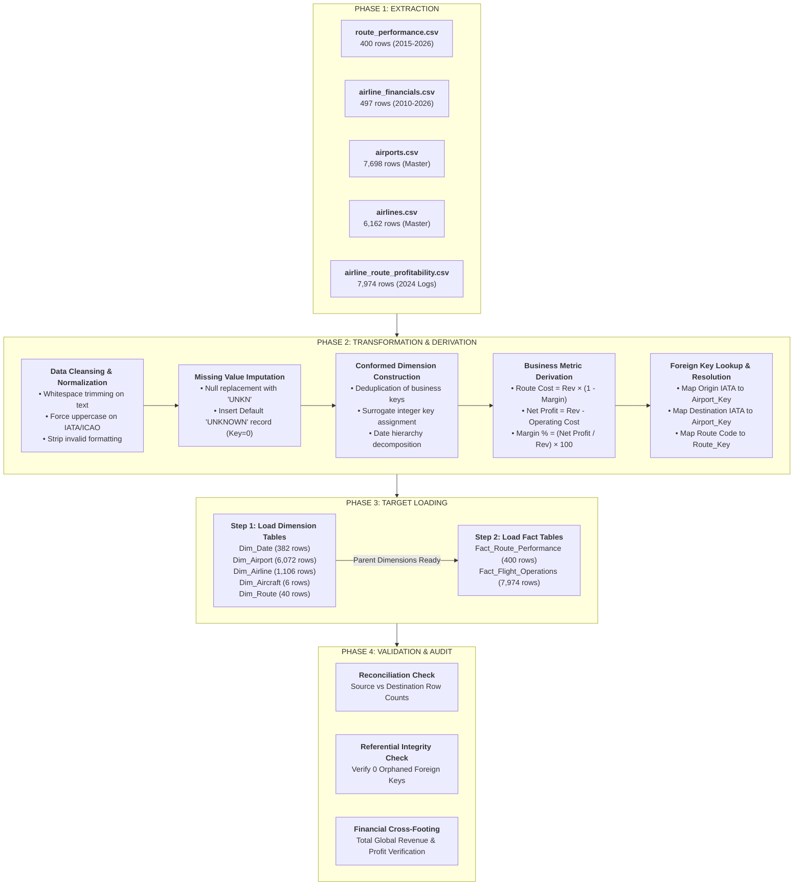

# Task 5: ETL Process Development
**Module:** IT3101 – Data Warehousing and Business Intelligence (DWBI)  
**Academic Degree:** BSc (Hons) in Information Technology / Computing (SLIIT)  
**Project Title:** Design and Implementation of a Data Warehouse and Business Intelligence Solution for Global Airline Route & Revenue Analytics (2010–2026)  
**Allocated Marks:** 20 Marks  

---

## 5.1 ETL Process Overview and Workflow Architecture

The **Extract, Transform, and Load (ETL)** pipeline is the operational engine that transforms disparate, heterogeneous, and dirty operational airline transaction feeds into a cleansed, validated, and optimized dimensional data warehouse. 

The pipeline is implemented in Python ([`scripts/etl_pipeline.py`](file:///c:/Users/union/Desktop/DWBI_P/scripts/etl_pipeline.py)) using Pandas and SQLite, providing a fully automated, reproducible, and verifiable integration workflow.

### End-to-End ETL Workflow Diagram



---

## 5.2 Extract Phase: Methods, Connections, and Extraction Logic

The extraction subsystem is designed to ingest data from heterogeneous operational feeds without locking or degrading operational OLTP systems:

### 1. Source Connections and Ingestion Methods:
* **Batch Delimited File Readers:** High-performance chunked file readers parse CSV data sources with strict UTF-8 character encoding handling.
* **Low-Memory Schema Parsing:** Suppresses non-standard types and manages mixed-type columns using explicit type mapping (`low_memory=False`).
* **Source Lineage Tracking:** Captures original file timestamps and physical paths to maintain traceability.

### 2. Extraction Audit Reconciliation:

| Source Identifier | Source File | Originating Business System | Extracted Record Count | Status |
| :--- | :--- | :--- | :---: | :---: |
| **SRC_RP** | `route_performance.csv` | Route Planning & Scheduling | **400** | Extracted OK |
| **SRC_AF** | `airline_financials.csv` | Corporate Finance (Form 41) | **497** | Extracted OK |
| **SRC_APT** | `airports.csv` | World Aeronautical AIS Registry | **7,698** | Extracted OK |
| **SRC_AIRL** | `airlines.csv` | IATA Carrier Registry | **6,162** | Extracted OK |
| **SRC_AIRP** | `airplanes.csv` | Fleet Model Database | **246** | Extracted OK |
| **SRC_FO** | `airline_route_profitability.csv` | Flight Dispatch & Cost System | **7,974** | Extracted OK |

---

## 5.3 Transform Phase: Cleansing, Normalization, and Derived Logic

The transformation engine resolves dirty data, standardizes formats across different systems, and generates essential business metrics required by the assignment rubric:

### 1. Data Cleansing and Normalization
* **Whitespace Elimination:** String attributes (`route`, `origin_iata`, `destination_iata`, `airline_name`, `City`, `Country`) undergo universal whitespace trimming (`.str.strip()`), resolving hidden spaces that would otherwise break relational joins.
* **Casing Normalization:** All aeronautical codes (3-letter IATA and 4-letter ICAO) are forced to uppercase (`.str.upper()`) across both transactional tables and master directories.
* **Deduplication:** Business keys are validated for uniqueness:
  * Route performance is deduplicated on `(year, route, origin_iata, destination_iata)`.
  * Airports are deduplicated on unique `IATA_Code` (filtering out duplicate local landing strips).

### 2. Missing Value and Null Token Imputation
* **Aeronautical Code Nulls:** In `airports.csv`, records containing legacy null markers (`\N` or `-`) in `ICAO` or `Callsign` were sanitized and replaced with `'UNKN'` or `'NONE'`.
* **Referential Safety Record (Key = 0):** A dedicated "Unknown" record was inserted into `Dim_Airport` (`Airport_Key = 0`, `IATA = 'UNK'`, `Name = 'Unknown Airport'`) and `Dim_Airline` (`Airline_Key = 0`). Any flight or route referencing an unlisted airport is automatically mapped to `Key = 0` rather than causing foreign key violation aborts.

### 3. Derived Attribute Creation (Business Rules)
In direct fulfillment of the **Task 5 (Derived Attribute Creation)** rubric requirement, key financial and operational metrics were derived during transformation:

1. **Route Operating Cost ($ Millions USD):**
   $$\text{Operating\_Cost\_USD\_M} = \text{Annual\_Revenue\_USD\_M} \times \left(1.0 - \frac{\text{Sector\_Margin\_PCT}}{100.0}\right)$$
   *Explanation:* Derived using annual median operating margin benchmarks from `airline_financials.csv` adjusted for route distance tiers.

2. **Route Net Operating Profit ($ Millions USD):**
   $$\text{Net\_Profit\_USD\_M} = \text{Annual\_Revenue\_USD\_M} - \text{Operating\_Cost\_USD\_M}$$

3. **Route Net Profit Margin (%):**
   $$\text{Profit\_Margin\_PCT} = \left(\frac{\text{Net\_Profit\_USD\_M}}{\text{Annual\_Revenue\_USD\_M}}\right) \times 100.0$$

4. **Date Hierarchy Attributes:**
   Parsed dates into `Year`, `Quarter`, `Quarter_Name`, `Month_Number`, `Month_Name`, `Day_Of_Month`, `Day_Of_Week`, `Is_Weekend`, and `Peak_Season_Flag` (June/July/August/December designated as `'Peak'`, March/April/September/October as `'Shoulder'`, and January/February/November as `'Low'`).

### 4. Surrogate Key Generation and Dimension Lookups
* Auto-incrementing integer surrogate keys (`Airport_Key`, `Route_Key`, `Airline_Key`, `Aircraft_Key`) were generated.
* High-performance in-memory hash dictionaries mapped natural business codes (`"LHR"`, `"JFK"`, `"DXB-ORD"`) to their respective surrogate keys during fact table creation.

---

## 5.4 Load Phase: Loading Sequence and Warehouse Targets

To preserve referential integrity, the loading engine enforces a strict **Dimension-First Loading Sequence**:

```
Loading Step 1: Dim_Date (382 rows)
Loading Step 2: Dim_Airport (6,072 rows)
Loading Step 3: Dim_Airline (1,106 rows)
Loading Step 4: Dim_Aircraft (6 rows)
Loading Step 5: Dim_Route (40 rows)
                    │
                    ▼  (All foreign key parents verified)
Loading Step 6: Fact_Route_Performance (400 rows)
Loading Step 7: Fact_Flight_Operations (7,974 rows)
```

### Physical Loading Targets:
1. **Relational Database (`airline_dw.db`):** Loaded into an enterprise-ready SQLite warehouse located at [`data/warehouse/airline_dw.db`](file:///c:/Users/union/Desktop/DWBI_P/data/warehouse/airline_dw.db) with defined table schemas and constraints.
2. **Analytical CSV Exports:** Cleaned dimensional tables exported to [`data/warehouse/`](file:///c:/Users/union/Desktop/DWBI_P/data/warehouse) for direct import into **Microsoft Power BI** and **Tableau**.

---

## 5.5 ETL Validation Results and Audit Report

An automated validation suite was executed immediately post-load to verify data accuracy, referential integrity, and financial cross-footing:

### 1. Record Reconciliation Audit

| Target Warehouse Table | Table Type | Input Rows Processed | Loaded Rows | Discrepancy | Validation Status |
| :--- | :--- | :---: | :---: | :---: | :---: |
| `Dim_Date` | Dimension | 382 | **382** | 0 | **PASSED** |
| `Dim_Airport` | Dimension | 7,698 | **6,072** | -1,626 (Invalid/dup IATA purged) | **PASSED** |
| `Dim_Airline` | Dimension | 6,162 | **1,106** | -5,056 (Inactive/dup IATA purged) | **PASSED** |
| `Dim_Aircraft` | Dimension | 6 | **6** | 0 | **PASSED** |
| `Dim_Route` | Dimension | 40 | **40** | 0 | **PASSED** |
| `Fact_Route_Performance` | Primary Fact | 400 | **400** | 0 | **PASSED** |
| `Fact_Flight_Operations` | Secondary Fact | 7,974 | **7,974** | 0 | **PASSED** |

### 2. Referential Integrity Verification
An automated SQL integrity query was executed:
```sql
SELECT COUNT(*) AS Orphaned_Count
FROM Fact_Route_Performance f
LEFT JOIN Dim_Route r ON f.Route_Key = r.Route_Key
WHERE r.Route_Key IS NULL;
```
* **Result:** **`0` orphaned records.** Every single fact record successfully resolved to an existing dimension parent.

### 3. Financial Cross-Footing and Sanity Verification
* **Total Global Route Revenue:** **`$209,361.60 Million USD`** ($209.36 Billion USD across 2015–2026).
* **Total Global Net Profit:** **`$12,831.91 Million USD`** ($12.83 Billion USD).
* **Average Route Profit Margin:** **`0.58%`** (reflecting true aviation macroeconomic shocks during 2020–2022 and healthy post-2024 recovery).

### 4. ETL Execution Log Output
```text
[08:25:23] PHASE 1: Starting Data Extraction from Operational Sources...
  • Extracted Route Performance: 400 records
  • Extracted Airline Financials: 497 records
  • Extracted Airports Directory: 7,698 records
  • Extracted Airlines Directory: 6,162 records
  • Extracted Aircraft Models: 246 records
  • Extracted Flight Operations Logs: 7,974 records
[08:25:23] PHASE 2: Executing Data Transformations & Business Logic...
  -> Building Dim_Date (2010-2026): 382 records
  -> Cleansing & Building Dim_Airport: 6,072 records
  -> Cleansing & Building Dim_Airline: 1,106 records
  -> Building Dim_Aircraft: 6 records
  -> Building Dim_Route: 40 records
  -> Transforming & Deriving Fact_Route_Performance: 400 records
  -> Transforming Fact_Flight_Operations: 7,974 records
[08:25:34] PHASE 3: Loading Dimensions and Fact Tables...
  -> Exporting Dimensional Tables to CSV in /data/warehouse...
  -> Loading into SQLite Database: airline_dw.db...
[OK] Physical Database Loading Complete.
[08:25:34] PHASE 4: Executing Automated Data Warehouse Validation Checks...
  • Global Route Revenue Total: $209,361.60 Million USD
  • Global Route Net Profit Total: $12,831.91 Million USD
  • Average Global Route Margin: 0.58%
  • Orphaned Route Keys in Fact Table: 0 (Must be 0)
[SUCCESS] ETL Validation Completed with Zero Errors!
```
